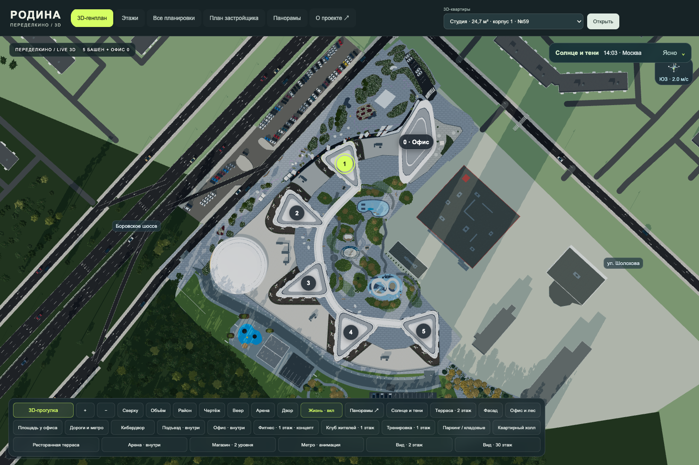

# Родина Переделкино · интерактивная 3D-концепция

**Зайти во двор, пройти по променаду, подняться в квартиру и посмотреть из её окон — ещё до переезда.** Независимый любительский веб-проект, вдохновлённый жилым комплексом [«Родина Переделкино»](https://rodina-peredelkino.ru/) от [Группы Родина](https://rodinagroup.com/).

[**Открыть работающую 3D-прогулку**](https://r-peredelkino.github.io/r_peredelkino/) · [Авторская концепция](docs/CONCEPT.md) · [Развитие v38](docs/ROADMAP-v38.md) · [Задачи и предложения](https://github.com/r-peredelkino/r_peredelkino/issues) · [Официальный сайт ЖК](https://rodina-peredelkino.ru/)

Это **неофициальная реконструкция и авторская концепция**, созданная независимо от застройщика. Приложение показывает нашу интерпретацию опубликованных материалов и собственные идеи развития среды. Архитектурный проект, планы, исходные визуализации и торговые обозначения принадлежат соответствующим правообладателям.

**Группа создателей концепта @r_peredelkino.** После публикации на GitHub к нам присоединились программисты, которые тоже приобрели квартиры в этом ЖК. Теперь мы вместе развиваем проект, которым смогут пользоваться будущие жители, соседи и гости.



## Новое в v38

Общий мир препятствий для прогулки и жителей; 52 участника с пробежками, собаками, велосипедами, курьерами и роботами; четыре модели автомобилей; «Тихая гостиная» под веером 4–5 с тремя местами через E; звуки леса прямо в прогулке и пять профилей качества. Башни, фасады и исходные посадки сохранены.

Проверено 1286 условий в 16 CPU-наборах; все 1913 ресурса поставки доступны. В браузере проверены геометрия, помещения, новый двор и все 17 моделей квартир. [Результаты и ограничения](docs/RELEASE-v38.md).

## Что можно посмотреть

| Часть проекта | Возможности |
| --- | --- |
| Комплекс | Пять жилых башен и офисный центр, общий обзор и прогулка на уровне человека |
| Двор и улица | Озеленение, дорожки, проходы, променад, коммерческие фасады, мост и верхний веер |
| Киберспортивная среда | Арена, демонстрационные интерьеры и авторские интерактивные элементы двора |
| Входы и общественные пространства | Лобби, лифтовые и квартирные холлы, клубные помещения, детские и спокойные зоны, кофейня, фитнес, магазин, офис и паркинг — в пределах реализованных маршрутов и шоурумов |
| Квартиры | **17 отдельных 3D-примеров**, мебель, комнаты, оконные проёмы, положение на этаже и вид на комплекс |
| Каталог | **203 архивные 2D-карточки** со снимка от **9 октября 2026 года**, исходные изображения и планы этажей |
| Бытовые действия | Включить свет и телевизор; лечь на кровать или диван; сесть на стул или унитаз; встать и вернуться к прогулке |
| Среда | Время суток, солнечные тени, погодные режимы, ветер, демонстрационный трафик и сценарий очереди при выезде из паркинга |
| Сравнение | Исходные планы, рендеры и панорамные виды доступны отдельно от авторской 3D-сцены |

В v37 остекление примеров квартир согласовано с геометрией башен, включая криволинейные участки. Мебель и проходы проверены для прогулки. Телевизоры показывают авторскую анимацию; это демонстрация экранов, а не телевизионная трансляция.

## Как исследовать

1. Откройте 3D-генплан и осмотрите комплекс с общей камеры.
2. Переключитесь в прогулку. Выберите место или идите по доступным дорожкам самостоятельно.
3. Откройте реализованную входную группу или общественное пространство через подсказку взаимодействия.
4. Выберите один из 17 3D-примеров квартир. Сравните его с исходной 2D-планировкой, положением на этаже и фасадом.
5. Войдите внутрь, пройдите по комнатам, включите свет и телевизор, попробуйте бытовые ракурсы.
6. Измените дату и время, чтобы посмотреть, как меняются освещение, тени и впечатление от вида.

| Управление | Действие |
| --- | --- |
| Мышь / перетаскивание вида | Осмотреться; в общем обзоре — управлять камерой |
| `W A S D` или стрелки | Идти в режиме прогулки |
| `E` | Взаимодействовать с доступным предметом рядом |
| Список объектов и кнопка действия | Перейти к доступному взаимодействию в квартире |
| «Встать» | Вернуться из сидячего или лежачего ракурса |
| `Esc` | Встать или выйти из текущего режима, в зависимости от открытого пространства |
| Два экранных стика на телефоне | Движение и осмотр |

## Запуск и публикация

Для просмотра нужен современный браузер с **WebGL 2** и включённым аппаратным ускорением. Для локального запуска и проверок установите **Node.js 24 или новее** вместе с npm и Git. Файлы нужно отдавать через HTTP: открытие `index.html` двойным щелчком ограничивает загрузку модулей и ресурсов.

```bash
git clone https://github.com/r-peredelkino/r_peredelkino.git
cd r_peredelkino
npm ci --ignore-scripts
npm run vendor:check
npm test
npm run dev
```

Откройте **http://127.0.0.1:4173/r_peredelkino/**. Сервер слушает локальный интерфейс; `Ctrl+C` останавливает его. Для другого порта используйте, например, `npm run dev -- --port 4174`.

### Проверки и сборка

| Команда | Результат |
| --- | --- |
| `npm ci --ignore-scripts` | Установить точные зависимости из `package-lock.json` без запуска install-скриптов |
| `npm run vendor:check` | Сверить браузерные библиотеки в `dist/vendor` с установленными пакетами и контрольными суммами |
| `npm test` | Запустить CPU-наборы проверок модели, действий и новых сценариев двора, затем проверить ссылки и публичную поставку ресурсов через HTTP |
| `npm run test:cpu` | Запустить только проверки геометрии, квартир и общественных помещений |
| `npm run test:assets` | Проверить статические файлы, локальные импорты, пути, типы и размеры HTTP-ответов |
| `npm run build` | Создать статическую поставку `.pages` из канонического каталога `dist` |
| `npm run dev` | Открыть локальный сервер разработки на порту 4173 |

Сборка копирует `dist` в `.pages`, сохраняет относительные пути и добавляет `.nojekyll`. Серверный API, база данных и отдельная сборка 3D-модели для просмотра не требуются. Полная поставка включает свои локальные ресурсы; архив одних изменений версии не заменяет полный проект.

Для проверки собранного сайта:

```bash
npm run build
npm run dev -- --dir .pages --port 4174
```

Адрес проверки: **http://127.0.0.1:4174/r_peredelkino/**.

### GitHub Pages

Публичная ссылка: **https://r-peredelkino.github.io/r_peredelkino/**.

В репозитории используется GitHub Actions. Публикация настроена в **Settings → Pages → Source → GitHub Actions**. При push в `main` workflow устанавливает зависимости, проверяет vendor, запускает тесты, собирает `.pages` и публикует прошедший проверки артефакт. Pull request проходит проверки без публикации. Workflow можно запустить вручную через **Actions → Validate and publish 3D masterplan → Run workflow** на `main`.

Используемые GitHub Actions закреплены полными SHA коммитов. В приложение не нужно добавлять GitHub-токен; публикация использует разрешения workflow. Не коммитьте `node_modules`, сгенерированный `.pages`, ключи, профили браузера и личные файлы.

### Зависимости

| Компонент | Закреплённая версия | Назначение |
| --- | --- | --- |
| Three.js | `0.186.1` | 3D-сцена, материалы, камеры и отрисовка |
| polygon-clipping | `0.15.7` | Операции с контурами геометрии |

Браузер получает проверенные локальные файлы из `dist/vendor`; версии зависимостей закреплены в `package.json` и lockfile. При согласованном обновлении зависимости обновите lockfile, выполните `npm run vendor:sync`, затем `npm run vendor:check`, `npm test` и `npm run build`. Новую версию Three.js дополнительно проверяйте в браузере: успешная установка npm сама по себе не проверяет изображение и поведение камеры.

### Структура репозитория

| Путь | Содержание |
| --- | --- |
| `dist/` | Каноническое статическое приложение: HTML, CSS, модули 3D и интерфейса |
| `dist/assets/` | Ресурсы просмотра: планы, изображения, панорамные тайлы и другие ассеты |
| `dist/vendor/` | Локальные версии библиотек, уведомления об их правах и контрольные суммы |
| `references/` | Источники, сверка опубликованных материалов и ограничения реконструкции |
| `tools/` | Проверки геометрии и интерактивных сценариев, история инструментов разработки |
| `scripts/` | Переносимые команды запуска, проверки, сборки и синхронизации vendor |
| `.github/workflows/` | Проверки и публикация GitHub Pages |
| `docs/CONCEPT.md` | Авторская позиция и замысел проекта |
| `docs/ROADMAP-v38.md` | Следующие задачи, порядок реализации и критерии проверки |
| `ATTRIBUTION.json` | Источники архитектуры, изображений, географических данных и программных компонентов |

Основная 3D-сцена и планировки находятся в поставке приложения. Получение текущей погоды и переходы к внешним материалам требуют подключения к интернету. Доступность официальных сайтов и внешних панорам может меняться.

Если вид не появился, проверьте поддержку WebGL 2 и аппаратное ускорение браузера. Если после обновления осталась старая версия, выполните полную перезагрузку: `Ctrl+Shift+R` или `Cmd+Shift+R`. При ошибке ресурса приложите его URL и сообщение консоли к Issue.

## Точность и границы концепции

- Геометрия восстановлена по опубликованным рендерам, панорамам, генплану и планам этажей. Проект не является обмерной моделью, BIM-моделью или рабочей документацией.
- 17 меблированных 3D-примеров не означают, что все типы квартир уже реконструированы. Архив содержит 203 карточки и 107 уникальных изображений планов; это разные показатели.
- Каталог фиксирует состояние источника на 09.10.2026 и **не показывает текущую доступность квартир в продаже**. За актуальными условиями обращайтесь на [официальный сайт ЖК](https://rodina-peredelkino.ru/).
- Мебель, бытовые сценарии, часть интерьеров и технологичных элементов двора — авторские предложения. Их наличие в сцене не означает обещание застройщика установить их в реальном комплексе.
- Солнечные тени помогают исследовать модель, но не являются заключением об инсоляции. Упрощённые геометрия окружения и параметры остекления влияют на результат.
- Автомобильная анимация, плотность движения, фазы светофоров и расчёт очереди — **сценарии с заданными допущениями**, а не прогноз измеренных пробок. Точное устройство рампы и пропускная способность паркинга требуют инженерных схем.
- Архивный план квартиры `2-588` сохранён с датой снимка: при проверке 12.10.2026 новый официальный адрес изображения возвращал пустой ответ. Соответствие архивного плана новому файлу не заявляется.

Происхождение квартир и ограничения зафиксированы в [references/apartments-v37.json](references/apartments-v37.json). Источники общественных помещений и офиса находятся в каталоге [references](references/). Изменения версии описаны в [CHANGELOG-GENPLAN-v37.md](CHANGELOG-GENPLAN-v37.md).

## Создатели и источники

**Группа создателей концепта @r_peredelkino** разрабатывает приложение, реконструирует пространственную модель и предлагает собственные сценарии прогулки и благоустройства.

Архитектура, опубликованные планы и исходные визуализации: [ЖК «Родина Переделкино»](https://rodina-peredelkino.ru/) и [Группа Родина](https://rodinagroup.com/). Панорамы: Life Fly. Географические данные: **© OpenStreetMap contributors, ODbL 1.0**. Программная основа: Three.js, polygon-clipping и их компоненты. Подробные сведения об источниках сохраняются в [ATTRIBUTION.json](ATTRIBUTION.json) и каталоге [references](references/).

Исходные изображения сохраняются отдельно от нашей пространственной реконструкции. Так посетитель может сопоставить предложение команды с материалом, на который оно опирается.

## Зачем мы это сделали

«Сделано тремя программистами за булку хлеба и двадцать кофейных стаканов» — так мы с улыбкой рассказываем о начале проекта. После публикации команда выросла: к работе подключились новые соседи-программисты.

Нам очень жаль, что свободная прогулка по будущему дому ещё не стала привычной частью старта продаж. Покупатель должен иметь возможность самостоятельно рассмотреть двор, пройти до входа, зайти в квартиру и понять её масштаб. Такой стенд в офисе продаж и такая ссылка дома помогают задать хорошие вопросы и осознанно полюбить архитектуру.

Мы подробно объясняем эту позицию в [авторской концепции](docs/CONCEPT.md). Наша критика относится к подходу к презентации жилья; приложение остаётся самостоятельной любительской работой.

[Отчёт публикации, проверки и производительность](docs/PUBLICATION.md).

[Изменения v38 и результаты проверки](docs/RELEASE-v38.md).

## Куда движемся дальше

Мы развиваем двор как место, в котором хочется задержаться: прогулки и пробежки, велосипедисты, жители с собаками, курьеры, роботы-доставщики, отдых на лавочках, растительность и звуки леса. Новые маршруты должны учитывать проходы, клумбы, кусты, мебель и движение людей. Архитектуру фасадов и башен сохраняем.

В технологичных дворовых элементах вдохновляемся благоустройством Дубая: теневые навесы, спокойный вечерний свет, озеленённые места отдыха и удобные небольшие площадки для встреч. Важно, чтобы декорация служила человеку и не перекрывала проходы. Конкретные задачи и условия проверки собраны в [плане развития v38](docs/ROADMAP-v38.md).

В дальнейших версиях планируем прогулки по всем подтверждённым типам квартир, окна фитнеса на двор и оконные проёмы входных групп по опубликованным рендерам. Для большой сцены развиваем настройки качества, LOD и проверку поведения на разных устройствах.

Будущие направления — карты и прогулки на **Unity**, **Unreal Engine 5 и последующих версиях**, **Valve Source / Source 2** и других движках. Рассматриваем и многопользовательские проекты, в которых жители смогут вместе исследовать цифровой район. Эти направления находятся в плане развития; готовых портов в этом репозитории пока нет.

## Ошибки и развитие

Нашли расхождение, неудобный проход или ошибку камеры? Создайте [Issue](https://github.com/r-peredelkino/r_peredelkino/issues) с названием версии, устройством и браузером, местом в модели, шагами повторения и ссылкой на исходный материал. Для расхождения с проектом особенно полезны номер корпуса, этаж и идентификатор квартиры.

Разработку ведём **только в `main`**. Для этой работы не создаём новые ветки `feature/*`. Перед изменением обновите `main`, сохраните проверяемую резервную копию и согласуйте участок работы с командой, чтобы параллельные правки не затёрли друг друга. Делайте небольшие понятные коммиты; перед публикацией выполняйте проверки и смотрите результат в браузере.

Идеи новых функций приветствуются в Issues. К предложению полезно приложить схему, ракурс, источник или сценарий использования: где человек проходит, что видит и как взаимодействует с пространством.
